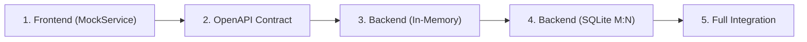

# AGENTS.md — Agent Operating Guide & Project Memory

This document is the **primary instruction manual and operational memory** for any AI agent working on the **Link Saver** repository. Every agent must consult this file before undertaking any work and must adhere to the rules and conventions defined herein.

---

## 1. Living Document Mandate (CRITICAL)

> **MANDATORY FOR ALL AGENTS**:
> Whenever you make significant architectural decisions, encounter new system constraints, discover environment-specific quirks, add new dependencies, or establish new conventions:
> **YOU MUST UPDATE THIS `AGENTS.md` FILE IMMEDIATELY.**
> Keep this document up to date so that subsequent agents have full context and never repeat past mistakes or breach project constraints.

---

## 2. Project Mission & Technology Stack

**Link Saver (v1)** is a responsive web application for saving, organizing, and exploring links with automated metadata extraction and specialized on-demand video streaming.

- **Frontend**: React 18/19, TypeScript, Vite, Tailwind CSS.
- **Backend**: FastAPI (Python 3.10+), Pydantic v2, Uvicorn.
- **Database & ORM**: SQLite (`app.db`), SQLAlchemy (relational $M:N$ model).
- **Video & Metadata**: `yt-dlp` (direct streaming for 720p YouTube videos), `httpx` + `BeautifulSoup4` (generic OpenGraph / HTML metadata extraction).
- **Authentication**: JWT Bearer tokens, passwords hashed with `bcrypt`.
- **Remote Repository**: `https://github.com/AslanMurzalin/Assigment1.2.git`

---

## 3. Scope Boundaries & Explicit Non-Goals (v1)

Agents must strictly respect the scope decided for v1:

| Feature | Status in v1 | Operational Guideline |
|---|---|---|
| **Web Interface** | **Active (Core)** | Responsive web only (supports 360px to 1920px viewports). |
| **Browser Extension** | **Deferred** | Do NOT build an extension in v1. Link submission happens via the website form. |
| **YouTube 720p Streaming** | **Active** | Direct streaming (`StreamingResponse`) only upon user click. **Zero permanent files stored on the server.** |
| **Ozon Extraction** | **Deferred** | Do NOT build an Ozon-specific scraper in v1. Treat Ozon links as generic sites. |
| **Generic Sites** | **Active** | Auto-extract HTML `<title>` and `<meta name="description">` (or OpenGraph fallback). |
| **Tags Architecture** | **Active ($M:N$)** | Relational normalized schema: `tags` table and `link_tags` junction table. |
| **Duplicate Links** | **Allowed** | Users may save identical URLs without conflict. |
| **Out of Scope** | **Excluded** | PWA, native apps, sharing/collaboration, import/export, audio-only extraction, resolution pickers. |

---

## 4. Strict Iteration Workflow

Development proceeds strictly in 5 distinct iterations. **Do not skip ahead.**



### Iteration 1: Frontend with `MockService`
- Build the entire responsive UI using `MockAuthService` and `MockLinkService`.
- Use `localStorage` + artificial network delay (200–400ms) to simulate real server behavior.
- **Rule**: No backend dependencies during this iteration. The frontend must be fully testable and demo-ready independently.

### Iteration 2: API Contract (`openapi.yml`)
- Single source of truth for the API contract at the project root (`openapi.yml`).
- Define all paths, DTO schemas, status codes, JWT security schemes, and streaming binary response.
- **Rule**: Validate the YAML file before proceeding to backend work.

### Iteration 3: Backend with In-Memory Storage
- Scaffold FastAPI and implement Pydantic v2 schemas matching `openapi.yml`.
- Implement clean architecture: Routers $\rightarrow$ Services $\rightarrow$ `AbstractUserRepository` / `AbstractLinkRepository` $\rightarrow$ `InMemoryRepository`.
- Implement metadata extractors and YouTube streaming.
- **Rule**: Must pass all automated tests in memory before touching SQLite.

### Iteration 4: Backend with SQLite Storage ($M:N$ Tags)
- Configure SQLite and declare SQLAlchemy models: `UserModel`, `LinkModel`, `TagModel`, `link_tags` junction table.
- Implement `SQLiteUserRepository` and `SQLiteLinkRepository` fulfilling the abstract repository interfaces.
- Implement relational search (`ilike`) and tag filtering (SQL joins).
- Switch FastAPI dependency injection (`api/dependencies.py`) to SQLite without altering routers or services.

### Iteration 5: Frontend + Backend Integration
- Implement `HttpAuthService` and `HttpLinkService` using Axios/Fetch with JWT interceptors.
- Swap mock services for real HTTP services via client-side dependency injection.
- Configure CORS and `.env` variables (`VITE_API_URL`).
- Run end-to-end smoke verification and deliver `README.md`.

---

## 5. Development & Code Conventions

### 5.1 Clean Architecture Rules
1. **Routers** handle HTTP protocols, query/path parameters, and status codes. They must never contain business logic or raw database queries.
2. **Services** contain core business logic (auth verification, extractor coordination, tag association).
3. **Repositories** isolate data storage mechanisms. Business services must depend on abstract repository interfaces (`AbstractLinkRepository`), not concrete classes.
4. **Client Services**: The frontend components consume interfaces (`IAuthService`, `ILinkService`), allowing mock services to be swapped for HTTP services without modifying UI components.

### 5.2 Security & Streaming Protocols
- Passwords must always be hashed with `bcrypt`. Never log or return passwords or hashes in API responses.
- All link queries must be strictly scoped to the authenticated user (`user_id == current_user.id`).
- Validate URLs on submission to protect against SSRF (block `localhost`, `127.0.0.1`, private IP blocks).
- **YouTube Direct Streaming & 0-Byte Prevention Protocol**:
  1. **DASH Separate Streams**: Modern YouTube videos rarely provide single combined progressive streams for 720p. The selector MUST be `bestvideo[height<=720]+bestaudio/best[height<=720]/bestvideo+bestaudio/best`.
  2. **On-The-Fly Muxing**: `imageio-ffmpeg` supplies the embedded `ffmpeg` binary location via `--ffmpeg-location`, enabling yt-dlp to stream merged audio+video directly to stdout with zero server file retention.
  3. **Windows Anonymous Pipe Deadlock**: Windows pipe buffers are limited to 4096 bytes. `subprocess.Popen` MUST use `stderr=subprocess.DEVNULL` (or drain stderr in a separate thread), otherwise unread stderr fills the OS pipe buffer and deadlocks stdout streaming.
  4. **JavaScript Runtime**: Supply `--js-runtimes node` if Node is detected in PATH to prevent deciphering errors on YouTube URLs.
  5. **Client-Side Size Validation**: In `httpLinkService.ts`, check `resp.data.size > 0` before triggering browser file download.
  6. **No Timeout on Video Stream**: The Axios request for `/download` MUST use `timeout: 0` to disable the global 60-second timeout. Large 720p videos (e.g., 30+ minutes) easily exceed 60 seconds of transfer time.
  7. **Page Unload Protection**: `LinkCard.tsx` registers a `beforeunload` event listener while `isDownloading === true`. This prevents accidental page refresh/close from silently killing an in-progress download.

### 5.3 Git & Task Tracking
- Track progress against `docs/tasks.md` and GitHub Issues on [AslanMurzalin/Assigment1.2](https://github.com/AslanMurzalin/Assigment1.2).
- When completing a task:
  1. Verify all acceptance criteria and "Done Means" conditions.
  2. Mark the corresponding item in `docs/tasks.md` as completed `[x]`.
  3. Close or reference the corresponding GitHub issue.
  4. Write atomic Git commits with clear commit messages (e.g., `feat: ...`, `fix: ...`, `docs: ...`).

---

## 6. Project Directory Map

```text
c:\Users\aslan\PycharmProjects\assigment1/
├── AGENTS.md                  # <-- THIS FILE (Agent instructions & operational memory)
├── openapi.yml                # (Created in Iteration 2) API contract specification
├── .gitignore                 # Git ignore patterns
│
├── docs/                      # Project documentation & issue resolution guides
│   ├── architecture.md        # System architecture, schemas, and diagrams
│   ├── tasks.md               # 5-iteration checklist of all atomic tasks
│   ├── scope.md               # Original v1 product requirements
│   ├── engineer.md            # Engineer & agent guidelines on resolving issues
│   ├── design.md              # Design system & Orange-White visual identity
│   └── QA.md                  # QA role specification & issue reopening protocol
│
├── frontend/                  # (Created in Iteration 1) Vite + React + TypeScript + Tailwind
│   ├── src/
│   │   ├── api/               # Client, contracts, services (Mock & HTTP)
│   │   ├── components/        # UI components (auth, links, search, common)
│   │   ├── hooks/             # Custom React hooks (useAuth, useLinks)
│   │   ├── pages/             # Route pages (Login, Register, Dashboard)
│   │   └── types/             # Domain TypeScript interfaces
│   ├── package.json
│   └── vite.config.ts
│
└── backend/                   # (Created in Iteration 3) FastAPI application
    ├── app/
    │   ├── api/               # Routers and dependency injection
    │   ├── core/              # Config, security, exceptions
    │   ├── schemas/           # Pydantic DTO models
    │   ├── models/            # SQLAlchemy ORM models
    │   ├── repositories/      # Abstract, InMemory, and SQLite implementations
    │   ├── services/          # Domain services & metadata extractors
    │   ├── db/                # SQLite connection session
    │   └── main.py            # FastAPI entry point
    ├── tests/                 # Automated pytest suite
    └── requirements.txt
```

---

## 7. Change Log & Agent Notes

*Record key decisions, environment notes, or workflow updates here:*

- **2026-10-19**:
  - Initialized repository and connected remote `https://github.com/AslanMurzalin/Assigment1.2.git`.
  - Created `docs/architecture.md` and `docs/tasks.md` across 5 iterations.
  - Resolved architectural decisions: removed browser extension from v1; removed Ozon scraper from v1; adopted normalized $M:N$ relational tags table; YouTube downloads use direct 720p streaming with zero server storage.
  - Created 39 GitHub issues on `AslanMurzalin/Assigment1.2` matching all tasks.
  - Created `AGENTS.md` as the operational manual and living memory.
  - Moved documentation files to `docs/` (`architecture.md`, `tasks.md`, `scope.md`) and created `docs/engineer.md` with instructions on how to solve issues.
  - Completed all 10 Iteration 1 frontend tasks using `MockService` and closed issues #1–#10.
  - Established **Orange & White** visual identity across the entire UI and documented all rules in `docs/design.md`.
  - Completed Iteration 2: Generated and validated comprehensive `openapi.yml` API contract and closed issues #11–#15.
  - Completed Iteration 3: Scaffolded FastAPI backend with clean architecture, in-memory repository, JWT authentication, OpenGraph + YouTube extractors, direct video streaming, and verified with pytest suite; closed issues #16–#25.
  - Completed Iteration 4: Configured SQLite engine (`app.db`), declared SQLAlchemy models (`UserModel`, `TagModel`, `LinkModel`, `link_tags`), implemented `SQLiteUserRepository` and `SQLiteLinkRepository` with tag deduplication and SQL join filtering, switched FastAPI dependency injection to SQLite, and verified full integration test suite; closed issues #26–#31.
  - Completed Iteration 5: Implemented real Axios client with JWT interceptor and 401 error handler, implemented `HttpAuthService` and `HttpLinkService` fulfilling `IAuthService` and `ILinkService`, configured `.env.development`, integrated live backend with frontend, verified end-to-end integration test suite, verified Vite build, wrote root `README.md`, and closed issues #32–#39.
  - **Issue #40 Resolution (Windows Streaming NotImplementedError)**: Resolved `NotImplementedError: _make_subprocess_transport` occurring when streaming YouTube video on Windows. Replaced `asyncio.create_subprocess_exec` with a thread-safe `subprocess.Popen` pipeline with `asyncio.to_thread` chunk reader. This eliminates event loop policy incompatibilities while maintaining direct non-blocking streaming with zero server-side file retention.
  - **Issue #41 Resolution (YouTube 0-Byte Video Download Fix)**: Fixed issue where modern YouTube videos without pre-merged progressive streams failed format selection `best[height<=720]/best` and returned 0 bytes. Integrated `imageio-ffmpeg` for embedded on-the-fly muxing, updated format selector to `bestvideo[height<=720]+bestaudio/best[height<=720]/bestvideo+bestaudio/best`, enabled Node.js JS runtime (`--js-runtimes node`), fixed Windows anonymous pipe deadlocks by avoiding blocking on stderr, and added frontend blob size verification.
  - **Issue #42 Resolution (Visual Filling Scale / Progress Bar)**: Replaced the generic spinning wheel on video download with an animated visual **filling scale / progress bar** styled in the Orange & White design language. Exposed CORS headers (`Content-Length`, `X-Estimated-Content-Length`), enhanced `ILinkService.downloadVideo` with `onProgress` callback, added real-time tracking of loaded bytes, total size, percentage, transfer speed, and estimated time remaining in `LinkCard.tsx`.
  - **Issue #43 Resolution (Large Video Timeout & Page Refresh Protection)**: Fixed `Timeout of 60000ms exceeded` error when downloading large YouTube videos (e.g., 30-minute videos at 720p). Set `timeout: 0` on the Axios download request in `httpLinkService.ts` to disable the 60-second global timeout for video streams. Added `beforeunload` event listener in `LinkCard.tsx` that activates during active downloads, preventing accidental page refresh/close from killing in-progress downloads by showing a browser confirmation dialog.
  - **Issue #44 Resolution (Slow Video Download Performance)**: Some videos downloaded much slower than others because yt-dlp picked VP9/AV1 codecs requiring expensive muxing. Updated format selector to prefer H.264 (`avc1`) video + AAC (`mp4a`) audio for fastest mux path. Added `--merge-output-format mp4` and ffmpeg `-movflags frag_keyframe+empty_moov+faststart` for fragmented MP4 output so streaming starts immediately instead of buffering for the moov atom. Increased chunk read size from 64KB to 256KB.
  - **Issue #45 Resolution (Video Duration/Seeking & Accelerated On-Demand Temp Muxing)**: Resolved issue where fragmented MP4 caused downloaded videos to display as live broadcasts without seekable duration. Switched streaming pipeline to download and mux into a temporary file on-demand. This lets yt-dlp run unconstrained concurrent audio/video downloading with full disk buffering and proper moov atom placement. The temporary file is streamed in 256KB chunks via `StreamingResponse` and immediately unlinked in a `finally` block, strictly preserving the zero permanent server storage rule.
  - **Issue #46 Resolution (Fix 0-Byte Detection with Isolated Temp Dir)**: Resolved `RuntimeError: yt-dlp failed to download the video` caused by `tempfile.mkstemp` leaving an empty 0-byte file before invoking `yt-dlp`. Switched to `tempfile.mkdtemp` and `--force-overwrites`, allowing yt-dlp to download and mux cleanly without skipping existing files, followed by complete removal with `shutil.rmtree` in the `finally` block.
  - **All 46 tasks and GitHub issues across all iterations are now 100% complete and closed.**
