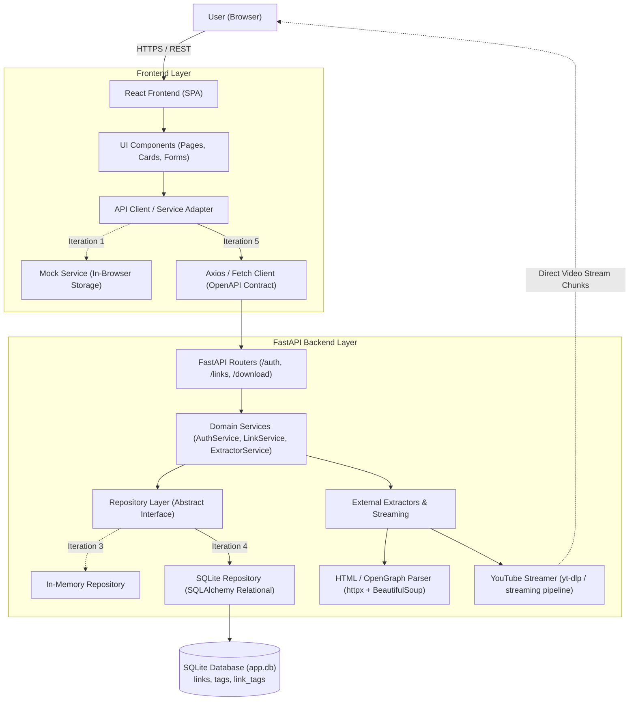
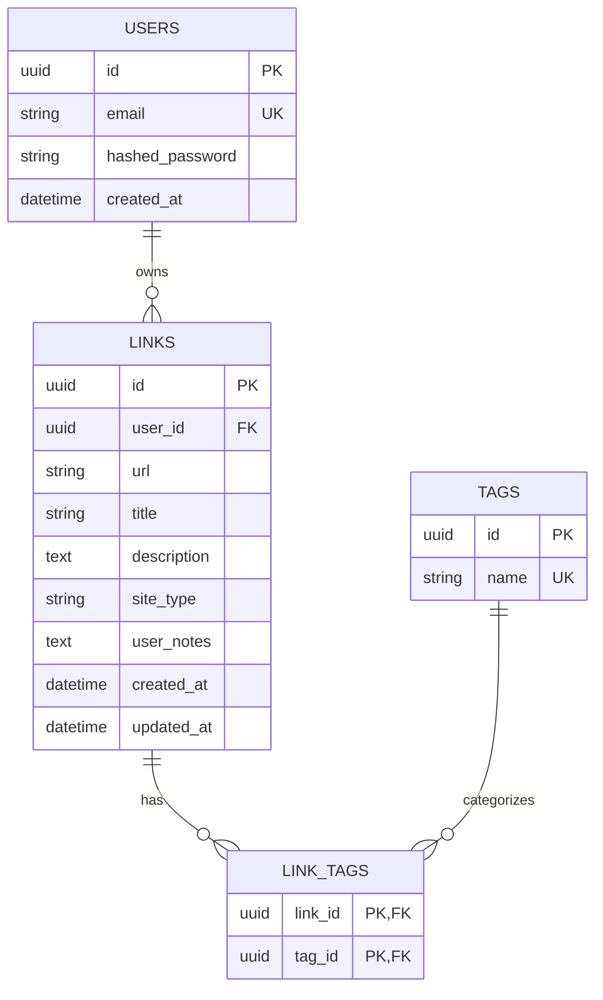

# Architecture Document: Link Saver (v1)

## 1. Overview & System Goals
**Link Saver** is a web application designed for bookmarking links with automatic metadata extraction, tagging, search, and specialized YouTube content handling (streaming 720p YouTube videos directly to the client's device, with standard metadata extraction for all other websites).

### Key Decisions & Scope (Updated)
- **Authentication**: Public signup and login (email + password).
- **Link Management**: Add links via URL paste on the website (browser extension is deferred for future versions).
- **Metadata Extraction**:
  - **YouTube**: Auto-fetches title/metadata; enables on-demand 720p direct streaming.
  - **Generic**: Standard page title and OpenGraph description parsing for all other websites.
  - **Ozon**: Deferred for future versions.
- **Organization & Tags**: Many-to-many ($M:N$) relational model (`tags` and `link_tags` junction table).
- **Search**: Case-insensitive search and filtering across title, user notes, and tags.
- **Duplicates**: Allowed.
- **Downloads & Streaming**: Direct video streaming for YouTube (no file stored on the server), starts only when the user clicks the "Download" button.
- **Interface**: Responsive website (FastAPI + React).

---

## 2. High-Level Architecture Diagram



---

## 3. Frontend Architecture (React + TypeScript)

### 3.1 Technology Stack
- **Framework**: React 18 / 19 + TypeScript + Vite.
- **Styling**: Tailwind CSS (mobile-first responsive layout).
- **State Management**: React Context / Zustand (Auth state) + React Query (TanStack Query) or custom hooks for server-state caching.
- **Architectural Pattern**: Service Layer / Adapter Pattern on the client.
  - UI components interact strictly through service interfaces (`IAuthService`, `ILinkService`).
  - In Iteration 1, `MockLinkService` and `MockAuthService` handle state inside browser memory / `localStorage`, simulating realistic network latency (`Promise` + `setTimeout`).
  - In Iteration 5, the mock service is swapped for `HttpLinkService`, interacting directly with the FastAPI backend.

### 3.2 Frontend Directory Structure
```text
frontend/
├── src/
│   ├── api/
│   │   ├── client.ts             # Base HTTP client with JWT interceptors
│   │   ├── contracts.ts          # TypeScript interfaces aligned with openapi.yml
│   │   └── services/
│   │       ├── authService.ts    # IAuthService (MockAuthService / HttpAuthService)
│   │       └── linkService.ts    # ILinkService (MockLinkService / HttpLinkService)
│   ├── components/
│   │   ├── auth/                 # LoginForm, RegisterForm
│   │   ├── links/                # LinkCard, LinkList, AddLinkForm, NotesEditor, TagBadge
│   │   ├── search/               # SearchBar, TagFilter
│   │   └── common/               # Layout, Navbar, Modal, Button, Spinner
│   ├── hooks/
│   │   ├── useAuth.ts
│   │   └── useLinks.ts
│   ├── pages/
│   │   ├── LoginPage.tsx
│   │   ├── RegisterPage.tsx
│   │   └── DashboardPage.tsx
│   ├── types/                    # Domain models (Link, User, Tag, FilterParams)
│   ├── App.tsx
│   └── main.tsx
```

---

## 4. Backend Architecture (FastAPI + Python)

### 4.1 Principles & Layering
- **Clean / Layered Architecture**:
  1. **API Layer (`routers`)**: Handles HTTP requests, validates DTOs via Pydantic v2, returns formatted HTTP responses.
  2. **Service Layer (`services`)**: Houses core business logic (password hashing, link extraction dispatch, tag association logic, search filtering).
  3. **Repository Layer (`repositories`)**: Decouples data access behind generic interfaces (`AbstractLinkRepository`, `AbstractUserRepository`, `AbstractTagRepository`).
     - *Iteration 3*: In-memory repositories (in-process dictionaries & sets).
     - *Iteration 4*: SQLite repositories with normalized relational tables and joins.
  4. **External Services**: HTML metadata parser and YouTube video stream generator.

### 4.2 Backend Directory Structure
```text
backend/
├── app/
│   ├── api/
│   │   ├── dependencies.py       # get_current_user, get_link_service, get_db
│   │   ├── v1/
│   │   │   ├── auth.py           # /api/v1/auth/signup, /api/v1/auth/login, /me
│   │   │   ├── links.py          # /api/v1/links (CRUD + search/filter)
│   │   │   └── downloads.py      # /api/v1/links/{id}/download (StreamingResponse)
│   ├── core/
│   │   ├── config.py             # App settings (Pydantic BaseSettings)
│   │   ├── security.py           # JWT creation/verification, password hashing (bcrypt)
│   │   └── exceptions.py         # Custom application exceptions and handlers
│   ├── schemas/                  # Pydantic models (matching openapi.yml)
│   │   ├── auth.py               # UserCreate, UserLogin, Token, UserRead
│   │   ├── tag.py                # TagRead, TagCreate
│   │   └── link.py               # LinkCreate, LinkUpdate, LinkRead, LinkFilter
│   ├── models/                   # ORM models (SQLAlchemy)
│   │   ├── user.py               # UserModel
│   │   ├── link.py               # LinkModel
│   │   └── tag.py                # TagModel & link_tags association table
│   ├── repositories/
│   │   ├── base.py               # Abstract interfaces (IUserRepository, ILinkRepository)
│   │   ├── in_memory.py          # In-Memory implementation
│   │   └── sqlite.py             # SQLite / SQLAlchemy implementation with M:N joins
│   ├── services/
│   │   ├── auth_service.py       # Authentication and user business logic
│   │   ├── link_service.py       # Link CRUD, M:N tag linking, search filtering
│   │   └── extractors/
│   │       ├── base.py           # BaseExtractor interface
│   │       ├── youtube.py        # YouTube metadata extraction and stream generator
│   │       └── generic.py        # Generic OpenGraph / HTML metadata parser
│   ├── db/
│   │   └── session.py            # SQLite engine and session factory
│   └── main.py                   # FastAPI entry point
├── tests/
└── requirements.txt
```

---

## 5. Entity & Relational Data Model (M:N Tags)

### 5.1 Tables & Relationships



- **`users` table**: Stores user credentials and registration timestamps.
- **`links` table**: Stores saved URLs, titles, descriptions, `site_type` (`youtube` | `generic`), and user notes.
- **`tags` table**: Normalized tag entities with unique names.
- **`link_tags` junction table**: Composite primary key `(link_id, tag_id)` implementing the many-to-many relationship.

---

## 6. Site-Specific Handlers & Streaming Pipeline

### 6.1 Site Type Detection (`site_type`)
When a URL is submitted, the domain is evaluated:
- `youtube.com` / `youtu.be` $\rightarrow$ `youtube`.
- All other hosts $\rightarrow$ `generic`.

### 6.2 YouTube (720p Streaming)
- **On Save**: Extract video metadata (title, author) via YouTube info inspector without downloading video media.
- **On Download Click**:
  - Endpoint: `GET /api/v1/links/{id}/download`.
  - The backend runs a streaming worker targeting 720p video and pipes the chunked stream directly to the response.
  - FastAPI wraps the generator in `StreamingResponse(chunk_generator(), media_type="video/mp4")` with `Content-Disposition: attachment; filename="<title>.mp4"`.
  - Zero disk storage is used on the server; bytes stream directly to the client browser.

### 6.3 Generic Sites
- Fetch page with `httpx`, extract HTML `<title>` and `<meta name="description">` (or OpenGraph tags). If extraction fails, fall back gracefully to the raw hostname.

---

## 7. Security & Scope Boundaries
1. **JWT Authentication**: Secured routes require `Authorization: Bearer <token>`.
2. **User Data Isolation**: Every link query is scoped strictly to `WHERE user_id == current_user.id`.
3. **SSRF & Abuse Protection**: Validate submitted URLs (require `http`/`https` protocols; block local addresses like `localhost`, `127.0.0.1`, private IP ranges).
4. **Streaming Bandwidth Guard**: Downloads only initiate on authenticated, explicit user click.
