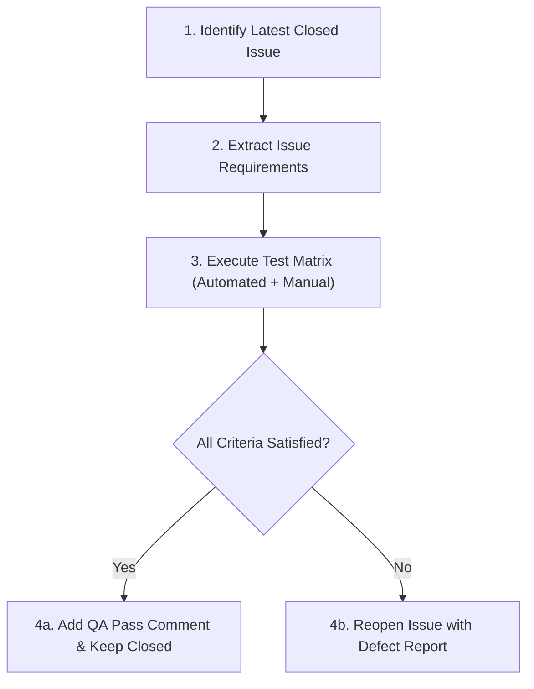

# QA.md — Quality Assurance Role & Protocol

This document defines the **Quality Assurance (QA) role**, operational responsibilities, verification workflows, and re-opening criteria for issues on the **Link Saver** repository.

---

## 1. Role Definition & Mission

The **QA Role (QA Engineer / QA Agent)** acts as the objective gatekeeper of quality and contract adherence. 

### Mission
To independently evaluate the latest closed issue against its explicit requirements, verify edge cases and environment constraints, and **reopen the issue immediately if acceptance criteria or quality standards are not fully satisfied**.

---

## 2. Core Principles of the QA Role

1. **Zero Assumption Validation**: Do not accept developer claims or passing green checkmarks at face value; run manual and automated tests against live runtime instances.
2. **Issue Specification as Law**: The GitHub Issue's **Acceptance Criteria**, **Done Means**, and **Constraints** are strict contractual requirements. If any bullet point fails or regresses, the issue fails inspection.
3. **Reopen to Redo**: When verification fails, the QA agent must reopen the GitHub issue, write a detailed bug report comment detailing repro steps and expected vs. actual behavior, and return the issue to the engineering queue.
4. **Living Memory Integrity**: Check that all architectural changes, new dependencies, or system workarounds were accurately recorded in `AGENTS.md`.

---

## 3. QA Verification Workflow



### Step 1: Identify the Target Issue
- Inspect closed issues on [AslanMurzalin/Assigment1.2/issues?q=is%3Aissue+is%3Aclosed](https://github.com/AslanMurzalin/Assigment1.2/issues?q=is%3Aissue+is%3Aclosed).
- Pick the most recently closed issue (or the issue under QA review).

### Step 2: Extract Issue Requirements
Review the issue body specifically for:
- **Acceptance Criteria**: List of exact features and behaviors.
- **Done Means**: Verification scenario.
- **Constraints**: Constraints such as zero server storage, visual identity (Orange & White), platform compatibility (Windows/Linux).

### Step 3: Execute Quality Evaluation Matrix
Perform rigorous verification across all applicable layers:

| Layer | Check | Verification Tool / Command |
|---|---|---|
| **Automated Tests** | Full pytest regression suite | `pytest backend/tests/ -v` |
| **Frontend Compilation** | TypeScript & bundle build | `npm run build` (inside `frontend/`) |
| **Runtime Execution** | Real HTTP requests & streaming | FastAPI on `:8000` + React on `:5173` |
| **Edge Cases** | Corrupted inputs, 0-byte checks, boundary viewports (360px–1920px) | Manual UI & API inspection |
| **Visual Identity** | Orange & White design language (`docs/design.md`) | Visual UI inspection |
| **Documentation** | Living document sync | Confirm `AGENTS.md` and `docs/tasks.md` are updated |

---

## 4. Defect Reporting & Reopening Protocol

If **ANY** of the following conditions occur:
- Acceptance Criteria or "Done Means" items are incomplete or failing.
- A regression was introduced in existing functionality.
- A 0-byte file or unhandled exception occurs (e.g., `NotImplementedError`, pipe deadlock).
- The visual presentation breaches the Orange-White design guidelines.
- Build or test commands fail (`npm run build` or `pytest`).

### Reopening Actions:
1. **Reopen the Issue on GitHub**:
   Change state from `closed` to `open`.
2. **Post QA Defect Comment**:
   The comment must follow this structured template:
   ```markdown
   ## ❌ QA Verification Failed — Reopening Issue

   ### 1. Defect Summary
   [Clear 1-line description of what failed]

   ### 2. Steps to Reproduce
   1. [Step 1]
   2. [Step 2]
   3. [Step 3]

   ### 3. Expected Behavior
   [What the Acceptance Criteria required]

   ### 4. Actual Behavior
   [What actually happened, including error logs or screenshots]

   ### 5. Failed Acceptance Criteria
   - [ ] [Specific criteria that was not satisfied]
   ```
3. **Notify Developer / Agent**: Return issue to the active backlog for rework.

---

## 5. QA Sign-Off Protocol (When Satisfied)

If **ALL** criteria pass with zero regressions:
1. Leave the issue in `closed` status.
2. Post a verification sign-off comment:
   ```markdown
   ## ✅ QA Verified & Passed
   - Verified on: [Date & Time]
   - Environment: [OS, Python version, Node version]
   - All acceptance criteria and done means validated.
   - Zero regressions detected.
   ```
