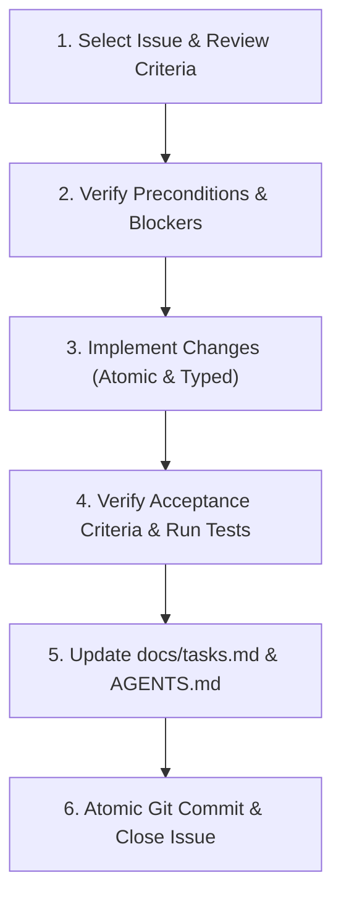

# Software Engineer Handbook & Issue Resolution Guide

This document defines the standard operating procedures, development lifecycle, and quality standards for engineers and AI agents resolving issues on the **Link Saver** repository.

---

## 1. Core Engineering Principles

1. **Strict Sequential Iterations**: Work strictly adheres to the 5 project iterations:
   $$\text{Frontend (Mock)} \longrightarrow \text{OpenAPI Contract} \longrightarrow \text{Backend (In-Memory)} \longrightarrow \text{Backend (SQLite)} \longrightarrow \text{Full Integration}$$
   Never skip ahead to future iteration tasks.
2. **Contract-Driven Development**: The frontend service interfaces (`IAuthService`, `ILinkService`) and OpenAPI contract (`openapi.yml`) dictate implementation shapes. Never bypass service contracts.
3. **Definition of Done (DoD) Rigor**: An issue is only complete when all **Acceptance Criteria** and **Done Means** conditions in the issue description are objectively satisfied.
4. **Zero Server Storage for Streaming**: Video downloads stream dynamically (`StreamingResponse`) with zero temporary or permanent disk storage.
5. **Living Document Sync**: Any architectural change, new dependency, or unexpected constraint discovered while solving an issue **must** immediately be reflected in `AGENTS.md`.

---

## 2. Issue Resolution Lifecycle

Follow these steps for every GitHub issue:



### Step 1: Issue Selection & Review
- Open the assigned GitHub issue on [AslanMurzalin/Assigment1.2/issues](https://github.com/AslanMurzalin/Assigment1.2/issues).
- Read the entire issue description:
  - **Acceptance Criteria**: Concrete checklist of features/tests.
  - **Done Means**: The tangible verification test.
  - **Out of Scope**: Explicit boundaries of what NOT to build.
  - **Constraints**: Security, performance, and architectural limitations.

### Step 2: Verification of Preconditions
- Ensure prerequisite tasks from earlier iterations are fully completed.
- Ensure the local workspace has a clean `git status`.
- Verify the active branch or create a descriptive feature branch:
  ```bash
  git checkout -b feat/issue-<id>-<short-description>
  ```

### Step 3: Implementation Guidelines by Iteration

#### When Working on Iteration 1 (Frontend with MockService):
- UI code lives in `frontend/src/`.
- **Never make real HTTP calls** in Iteration 1. Consume `MockAuthService` and `MockLinkService`.
- Maintain responsive Tailwind CSS layouts (test viewports: 360px mobile, 768px tablet, 1280px+ desktop).
- Store state in `localStorage` with synthetic 200–400ms `setTimeout` delay.
- YouTube cards render the Download button; generic cards omit it.

#### When Working on Iteration 2 (OpenAPI Contract):
- Edit `openapi.yml` at the project root.
- Adhere strictly to OpenAPI 3.0.3 specification standards.
- Explicitly define request bodies, query parameters, schemas, JWT bearer security, and binary streaming response (`video/mp4`).
- Validate the YAML file before finishing.

#### When Working on Iteration 3 (Backend In-Memory Storage):
- Backend code lives in `backend/app/`.
- Layering is mandatory:
  - `api/`: Routers and Pydantic schemas (validating HTTP input/output).
  - `services/`: Business logic, token generation, extractor coordination.
  - `repositories/`: Pure data storage (`dict` in memory). Services depend on `AbstractLinkRepository` / `AbstractUserRepository`.
- Metadata extractors must fail gracefully without crashing requests.
- Video downloads must stream bytes dynamically via `yt-dlp` stdout.

#### When Working on Iteration 4 (Backend SQLite with $M:N$ Tags):
- Define normalized SQLAlchemy models: `UserModel`, `LinkModel`, `TagModel`, and junction table `link_tags`.
- Implement `SQLiteUserRepository` and `SQLiteLinkRepository` fulfilling the abstract base classes.
- Ensure tag deduplication: reuse existing `TagModel` by name; do not duplicate tag rows.
- Implement search via `ilike` and tag filtering via SQL joins.
- Switch FastAPI dependency injection (`api/dependencies.py`) without modifying router logic.

#### When Working on Iteration 5 (Full Integration):
- Configure `frontend/src/api/client.ts` with base URL from `VITE_API_URL` and JWT interceptor.
- Implement `HttpAuthService` and `HttpLinkService` to replace mock implementations.
- Verify CORS preflight and headers between ports `5173` and `8000`.
- Perform end-to-end smoke testing across the entire user journey.

---

## 3. Verification & Quality Checklist

Before considering any issue resolved:

- [ ] **Type Safety**:
  - Frontend: `npm run build` or `npx tsc --noEmit` succeeds with 0 type errors.
  - Backend: Pydantic v2 schemas strictly validate payloads.
- [ ] **Automated Tests**:
  - Run `pytest` inside `backend/`: all tests pass cleanly.
- [ ] **Acceptance Criteria Verification**:
  - Walk through each bullet point under `## Acceptance Criteria` in the GitHub issue.
- [ ] **Done Means Verification**:
  - Perform the exact test described in `## Done Means` (e.g., UI inspection or API request).
- [ ] **Out of Scope Adherence**:
  - Ensure no unauthorized scope creep occurred (e.g., no browser extensions, no Ozon parsers, no file uploads).

---

## 4. Documentation & Closing Workflow

Once implementation and testing are verified:

1. **Update `docs/tasks.md`**:
   Find the matching task and change `[ ]` to `[x]`:
   ```markdown
   - [x] **Task X.Y: Task Title**
   ```

2. **Update `AGENTS.md` (if applicable)**:
   If any architectural design, environment detail, or dependency was introduced, log it in Section 7 (Change Log) of `AGENTS.md`.

3. **Commit with Conventional Commits**:
   Write atomic commits referencing the issue number:
   ```bash
   git add .
   git commit -m "feat(links): implement link card component with responsive layout (Closes #7)"
   git push origin <branch-name>
   ```

4. **Close the GitHub Issue**:
   Add a summary comment on the issue stating the verification steps performed and close the issue.

---

## 5. Troubleshooting & Common Pitfalls

| Issue / Symptom | Root Cause | Solution |
|---|---|---|
| **CORS error in browser console** | Backend CORS middleware not allowing frontend origin or headers. | Ensure `CORSMiddleware` in FastAPI includes `allow_origins=["http://localhost:5173"]`, `allow_credentials=True`, `allow_methods=["*"]`, `allow_headers=["*"]`. |
| **SQLite `ProgrammingError`: SQLite objects created in a thread...** | Thread safety restriction in SQLite driver. | Add `connect_args={"check_same_thread": False}` to `create_engine` in `backend/app/db/session.py`. |
| **Pydantic v2 validation errors on dates or UUIDs** | Type coercion differences in Pydantic v2. | Use `datetime.datetime` and string UUIDs with `model_config = ConfigDict(from_attributes=True)`. |
| **YouTube stream terminates prematurely** | Buffer underrun or process pipe closed. | Yield chunks of 64KB–256KB from process `stdout` in an async generator. |
| **Tailwind styles not applied** | Content paths missing in `tailwind.config.js`. | Ensure `content: ["./index.html", "./src/**/*.{js,ts,jsx,tsx}"]` is configured. |
| **401 Unauthorized loops** | JWT missing Bearer prefix or expired. | Check that HTTP client attaches `Authorization: Bearer <token>` and interceptor clears token only on true 401. |
